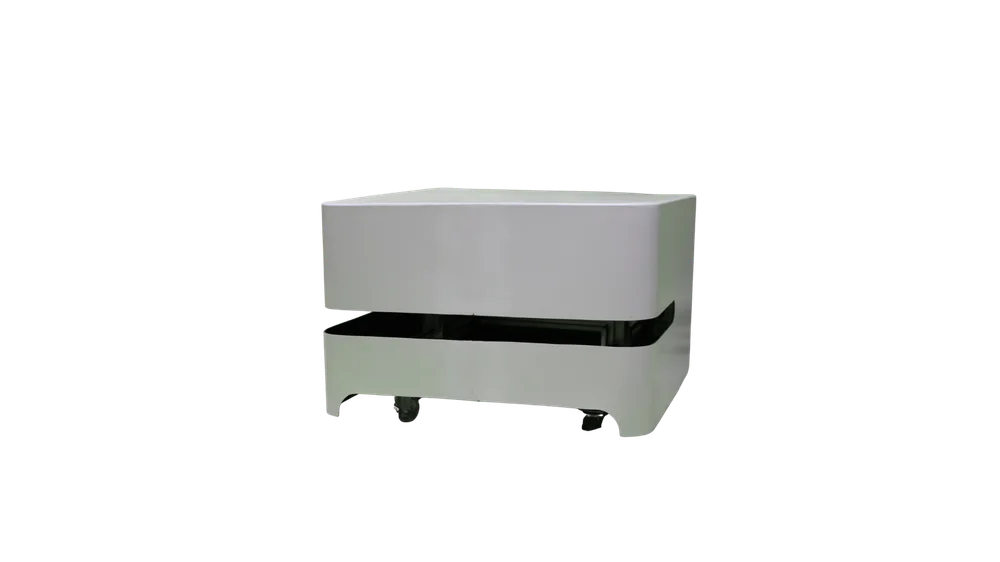
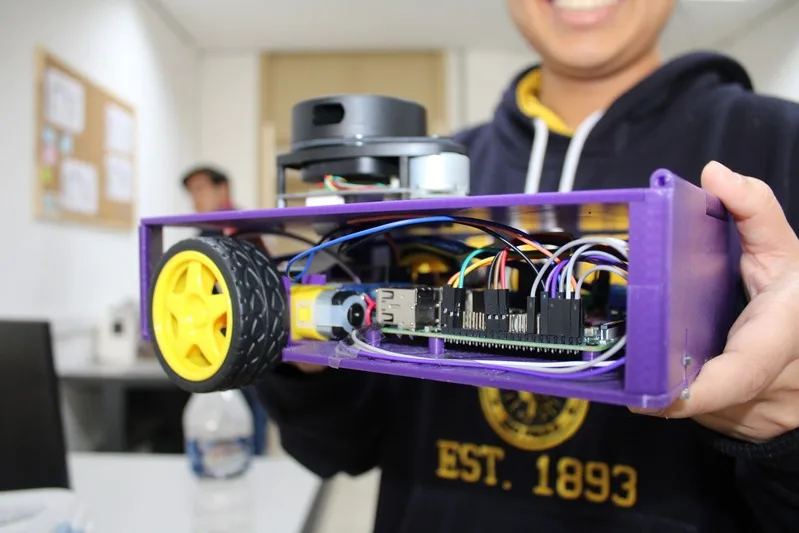
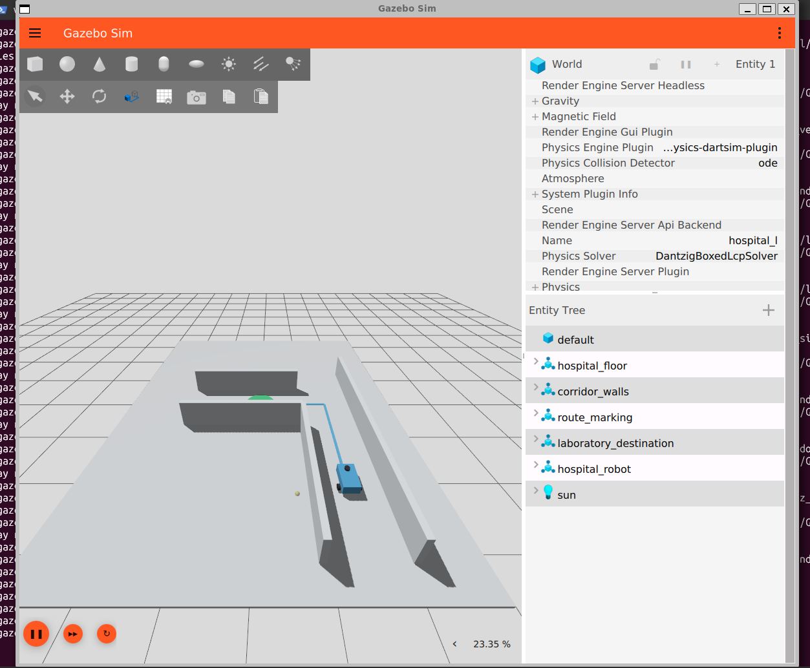
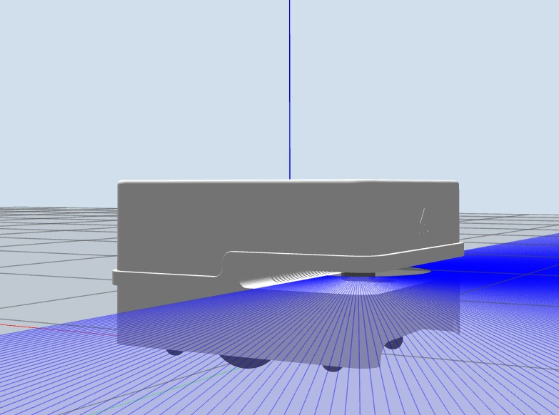

# Treinamento - Hemabot

> [!IMPORTANT]
> **Adendo anti-álibi da Molécula:** antes de começar a atividade, cada Molécula
> deve trabalhar em uma branch própria, usando um nome como
> `molecula-nome-sobrenome`. Tecnicamente, a branch é criada imediatamente
> **depois** do clone — o Git ainda não aprendeu a criar branch por telepatia —
> mas obrigatoriamente antes de alterar qualquer arquivo. Assim, o histórico
> ganha um crachá digital de quem fez o trabalho. Não vale mexer na `main` e
> depois dizer “confia, professor”.

Reconhecido como *O MELHOR PROJETO DA ZIMA*, o HemaBot é um robô desenvolvido no contexto da pandemia como uma forma de transportar amostras e exames laboratoriais de forma segura e automatizada dentro de ambientes hospitalares, evitando a exposição de profissionais a áreas contaminadas. Seu projeto passou por diversas versões de estrutura e aprimoramentos técnicos, incluindo a criação de um modelo alternativo compacto e eficiente chamado MiniHema, voltado para testes e validações rápidas.
Na área da computação, as tarefas se baseiam no estudo e na execução algoritmos e métodos de controle de trajetória. Outra responsabilidade é a configuração de componentes responsáveis pela navegação e percepção de obstáculos, em colaboração com os integrantes da eletrõnica. 

<p align="center">
  
  
</p>


## Ambiente adotado

- Windows 10 21H2 ou mais recente, ou Windows 11;
- WSL 2 com Ubuntu 24.04 LTS;
- ROS 2 Jazzy Jalisco;
- Gazebo Harmonic;
- integração `ros_gz`;
- Visual Studio Code instalado no Windows;
- extensão **WSL**, da Microsoft, instalada no Visual Studio Code;
- extensão **Python**, da Microsoft, recomendada.



O nome deste repositório é `treinamento_hemabot`. O pacote ROS 2 interno chama-se
`hospital_robot`, preservando os comandos usados nos guias da atividade.

## Primeiros passos da Molécula

Antes de começar, a Molécula deve preparar o WSL 2 com Ubuntu 24.04 seguindo o
[guia de instalação](docs/GUIA_INSTALACAO.md). Instale o Visual Studio Code no
Windows e adicione a extensão **WSL**, da Microsoft. A extensão **Python** também
é recomendada para facilitar a edição do exercício.

Depois, no terminal do Ubuntu, instale o Git e clone este repositório na pasta
pessoal:

```bash
sudo apt update
sudo apt install -y git
cd ~
git clone https://github.com/ZimaUSP/treinamento_hemabot.git
cd treinamento_hemabot
git switch -c molecula-nome-sobrenome
```

Abra o projeto no Visual Studio Code conectado ao Ubuntu:

```bash
code .
```

Na primeira execução, o VS Code instalará seu componente de integração no WSL.
Confirme que o canto inferior esquerdo da janela mostra
`WSL: Ubuntu-24.04`. Todos os comandos seguintes devem ser executados no
terminal integrado do VS Code, aberto pelo menu **Terminal > Novo Terminal**,
salvo quando o roteiro indicar outro local.

## Conteúdo

```text
treinamento_hemabot/
├── docs/                       # guias em Markdown e DOCX
├── scripts/                    # compilação, execução e testes
├── src/hospital_robot/
│   ├── hospital_robot/         # nós Python prontos
│   ├── launch/                 # inicialização do Gazebo e das missões
│   ├── models/                 # robô diferencial com LiDAR
│   ├── student_templates/      # arquivos incompletos para os alunos
│   ├── test/                   # validações estáticas
│   └── worlds/                 # mundos da atividade
├── instalar_robotica.sh        # instala ROS 2, Gazebo e ferramentas
└── verificar_instalacao.sh     # diagnostica o ambiente
```

## Início rápido

Depois de abrir o repositório no VS Code, use o terminal integrado:

```bash
cd ~/treinamento_hemabot
bash instalar_robotica.sh
```

Feche e abra o terminal. Depois execute:

```bash
cd ~/treinamento_hemabot
bash verificar_instalacao.sh
bash scripts/compilar_workspace.sh
source install/setup.bash
ros2 launch hospital_robot atividade.launch.py
```

Em outro terminal, ative o ambiente e explore o ROS 2:

```bash
cd ~/treinamento_hemabot
source /opt/ros/jazzy/setup.bash
source install/setup.bash
ros2 node list
ros2 topic list
ros2 topic echo /odom
```

Para iniciar a solução de demonstração:

```bash
ros2 run hospital_robot entrega_programada \
  --ros-args -p use_sim_time:=true
```

## Parte prática — roteiro da atividade

Depois de concluir a instalação e verificar o ambiente, a Molécula deve usar o
[Roteiro da atividade](docs/ATIVIDADE.md) como documento principal da parte
prática. O roteiro apresenta a sequência de comandos ROS 2, a simulação no
Gazebo, a movimentação do HemaBot e o exercício em Python. As instruções abaixo
são apenas um resumo dessa etapa.



O exercício de Python está em
`src/hospital_robot/student_templates/delivery_l.py`. A Molécula copia esse
modelo para o pacote pelo terminal integrado:

```bash
cp src/hospital_robot/student_templates/delivery_l.py \
  src/hospital_robot/hospital_robot/delivery_l.py
```

No explorador de arquivos do VS Code, abra
`src/hospital_robot/hospital_robot/delivery_l.py`, complete os trechos `TODO` e
salve com `Ctrl+S`. Depois, volte ao terminal integrado, recompile e execute:

```bash
bash scripts/compilar_workspace.sh
source install/setup.bash
ros2 run hospital_robot delivery_l \
  --ros-args -p use_sim_time:=true
```

Como o repositório usa Git, a solução original pode ser restaurada com:

```bash
git restore src/hospital_robot/hospital_robot/delivery_l.py
```

## Documentação

- [Guia de instalação](docs/GUIA_INSTALACAO.md): usado para preparar o ambiente.
- [Roteiro da atividade](docs/ATIVIDADE.md): deve ser seguido durante a parte
  prática.
- `docs/Guia_Instalacao_ROS2_Gazebo.docx`
- `docs/Atividade_Introducao_ROS2_Gazebo.docx`

## Validação do material

Os testes estáticos não exigem uma sessão gráfica do Gazebo:

```bash
bash scripts/testar_projeto.sh
```

Para uma verificação manual completa, compile o workspace, inicie a simulação e
confirme que `/cmd_vel`, `/odom`, `/scan` e `/clock` aparecem em
`ros2 topic list`.

<details>
  <summary>Bastidores do HemaBot</summary>
  <p align="center">
    
  </p>
</details>
